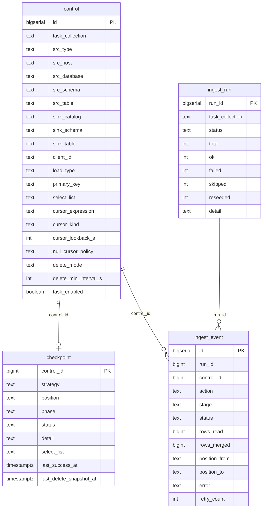
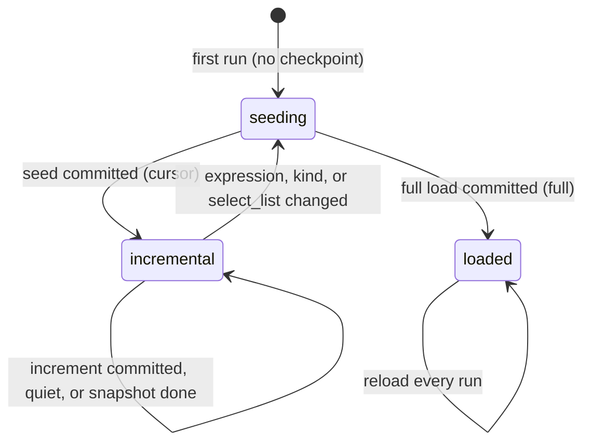

# Lakebase schema

All state lives in one Lakebase (Postgres) database, schema `lakefed_cursor`. The file
`src/lakefed_ingest/lakebase_schema.sql` holds the DDL. `state_store.SCHEMA_VERSION` is 2. The
job cluster reads and writes the tables through `psycopg` with an SDK-minted OAuth token. The
database is registered in Unity Catalog as `lakefed_cursor_lakebase` for DBSQL reads.



The diagram shows the key columns. The full lists are below. The relationships are logical, by id.
No foreign key enforces them. A deleted `control` row leaves its checkpoint and history behind. A
row added again later gets a new `id`, so it seeds from the start.

## `control`: what to ingest

One row per (source database, table). You maintain it. The job reads it once per run, for the run
`task_collection`. See "Control rows" in the [README](../README.md),
`specs/001-cursor-only-engine/contracts/control_row.md`, and `notebooks/load_control_example.ipynb`.

| Column | Meaning |
|---|---|
| `id` | primary key. Checkpoints and telemetry refer to it as `control_id` |
| `task_collection` | the run that ingests this row. One run is one collection |
| `task_enabled` | `false` skips the row and keeps its state |
| `tier`, `priority` | order inside a run: `tier`, then `priority`, then `id` |
| `src_type` | source adapter: `sqlserver`, `oracle`, `postgresql`, `mysql` |
| `src_host`, `src_port` | source server. A NULL port means the engine default |
| `src_database`, `src_schema`, `src_table` | source table. Oracle: `src_database` is the service name |
| `secret_key` | key in scope `lakefed-cursor` of the secret JSON for this database. See `contracts/secret_json.md` |
| `use_remote_query` | `true`: read through the UC connection in `src_connection` with `remote_query`. `src_host`, `src_port` and `secret_key` are not used then. Default `false` |
| `src_connection` | the UC connection for `use_remote_query`. With `src_host` NULL, the host fallback |
| `jdbc_options` | optional JSON object of extra Spark JDBC read options |
| `select_list` | comma-separated columns to copy. `*` is not supported. An added column reseeds the table |
| `primary_key` | comma-separated. Required for `cursor`. The MERGE key |
| `sink_catalog`, `sink_schema`, `sink_table` | target Delta table |
| `client_id` | optional. Set it to share one sink across many source databases. Written to sink column `__client_id__` |
| `client_attrs` | optional JSON object `{column: value}`. Each value is written as a STRING column on every row |
| `load_type` | load strategy: `cursor` (default) or `full` |
| `cursor_expression` | `cursor` only. One SQL expression in the source dialect over one to three columns of one type. `GREATEST` and `COALESCE` only |
| `cursor_kind` | `cursor` only. `rowversion`, `db_timestamp`, `app_timestamp`, or `identity` |
| `cursor_lookback_s` | `cursor` only. Lookback in seconds for a temporal kind. NULL means the job parameter `cursor_lookback_s` |
| `null_cursor_policy` | `reject` (default) fails a nullable input column. `seed_only` allows it. The seed copies a row with a NULL expression, and no increment reads it |
| `delete_mode` | `none` (default) or `pk_snapshot`. `soft_column` and `full_compare` are reserved and fail at plan time |
| `delete_min_interval_s` | seconds between PK snapshots. NULL means 86400 |
| `load_partitioned`, `partition_col`, `partition_size_mb` | optional partitioned seed or full load for large tables |

**Constraints.** CHECK constraints reject invalid rows:

| Name | Rule |
|---|---|
| `valid_load_type` | `load_type in ('cursor', 'full')` |
| `valid_src_type` | `src_type in ('sqlserver', 'oracle', 'postgresql', 'mysql')` |
| `valid_cursor_kind` | `cursor_kind` is NULL or one of the four kinds |
| `valid_delete_mode` | `delete_mode in ('none', 'soft_column', 'pk_snapshot', 'full_compare')` |
| `valid_null_cursor_policy` | `null_cursor_policy in ('reject', 'seed_only')` |
| `valid_cursor_metadata` | a `cursor` row has `primary_key`, `cursor_expression` and `cursor_kind` |
| `valid_full_metadata` | a `full` row has no `cursor_expression` and no `cursor_kind` |
| `valid_source` | `src_host` or `src_connection` is set |
| `valid_remote_query` | `use_remote_query` needs `src_connection` |
| `valid_intervals` | `cursor_lookback_s` and `delete_min_interval_s` are NULL or at least 0 |
| `valid_partitioning` | partitioned settings are complete |
| `valid_jdbc_options`, `valid_client_attrs` | the value is a JSON object |
| `valid_client_id` | `client_id` matches `^[A-Za-z0-9_.:-]{1,128}$` |

The unique index `control_sink_client_uq` allows one row per (sink, `client_id`). A dedicated sink
has one row. Two rows can never overwrite each other's data.

The columns `job_name`, `src_catalog`, `enable_iceberg_reads`, `sink_cluster_cols`,
`source_instance_group`, `warehouse_id`, `ct_enabled` and `cdc_capture_instance` of the root version
are dropped. Two more root version cursor columns are dropped, replaced by `cursor_expression`,
`cursor_kind` and `delete_mode`.

## `checkpoint`: where each table is

One row per control row. `control_id` is the primary key. The first run creates the row. Every
successful write updates it. The job reads all checkpoints of a collection in one query at the start
of a run.

| Column | Meaning |
|---|---|
| `control_id` | the control row this state belongs to |
| `src_database`, `src_schema`, `src_table` | copied from control, for readability |
| `strategy` | `cursor` or `full`. A different `load_type` in control means a reseed |
| `phase` | `seeding`, then `incremental` for `cursor`. `loaded` for `full` |
| `position` | `cursor`: JSON `{"expr", "kind", "type", "value"}`. `full`: NULL. See `contracts/position.md` |
| `status`, `detail` | `ok`, `running`, `failed` or `quarantined`. `detail` holds the last error or note, for example `alert=max_above_clock` |
| `select_list` | the columns the sink was last written with. A difference from `control.select_list` reseeds |
| `last_success_at` | last successful ingest. Used for freshness and lag |
| `last_delete_snapshot_at` | last PK snapshot for `delete_mode` `pk_snapshot`. NULL means never |
| `updated_at` | last change to this row |

**Position.** `expr` is the `cursor_expression` text at the last seed. `kind` is the `cursor_kind`
at the last seed. `type` is the source type of the expression result. `value` is digits for a
numeric type, ISO 8601 for a temporal type, a decimal integer for rowversion. A position with a
different `expr` or `kind` than the control row reseeds the table. The position never moves
backwards.

**Lifecycle.** The checkpoint moves forward only after the Delta commit succeeds. A failure never
skips data. The next run reads the window again, and the MERGE is idempotent.



A table reseeds in three cases: `select_list` gained columns, `cursor_expression` or `cursor_kind`
changed, or `load_type` changed. The reseed sets `phase` to `seeding` and `detail` to
`reseed_queued`.

**Force a reseed.** Set the phase back to `seeding`. The next run copies the table again:

```sql
update lakefed_cursor.checkpoint set phase = 'seeding' where control_id in (...);
```

## `ingest_run`: one row per run

The run start inserts the row with `status = 'running'`. The run end updates it.

| Column | Meaning |
|---|---|
| `run_id` | primary key. `ingest_event.run_id` refers to it |
| `task_collection` | the collection the run ingested |
| `job_run_id`, `cluster_id` | the Databricks job run and cluster, for the Jobs UI |
| `parallelism` | the run concurrency budget |
| `started_at`, `finished_at` | timing |
| `status` | `running`, then `completed`, `failed` (a table failed), or `skipped` (another run held the lock) |
| `total`, `ok`, `failed` | table counts |
| `skipped` | quiet tables, nothing to read |
| `reseeded` | tables set to reseed |
| `detail` | JSON: planning counts per route, timings, peak concurrency, `source_caps` with `max_queries_per_source` set, `table_retries` totals |

## `ingest_event`: one row per table per run

The table start inserts the row with `status = 'running'`. The table finish updates it. A table that fails
at stage `plan` also gets a `failed` event. A quiet cursor table gets no event. Its checkpoint
advances in bulk, `ingest_run.skipped` counts it, and its `last_success_at` is stamped. One event per
source database records the batched `MAX` capture.

| Column | Meaning |
|---|---|
| `id` | primary key |
| `run_id`, `task_collection`, `control_id` | the run and the control row |
| `src_database`, `src_schema`, `src_table`, `sink_fqn` | source and target, copied for convenience |
| `action` | `seed`, `increment`, `reseed`, `full`, or `capture` |
| `phase` | the checkpoint phase at the table start |
| `stage` | how far it got: `plan`, `capture`, `ensure_sink`, `read`, `seed`, `merge`, `load`, `snapshot`, `checkpoint`. On a failure, where it failed |
| `status` | `running`, then `ok` or `failed`. `skipped` for a reseed only set, or a capture event. `retried` for an attempt tried again in the same run |
| `started_at`, `finished_at`, `duration_ms` | timing |
| `rows_read`, `rows_merged` | row counts from the Delta commit metrics. A runtime that reports none leaves NULL. A capture event stores the captured table count in `rows_read` |
| `position_from`, `position_to` | position JSON before and after |
| `pool` | Spark FAIR pool the table ran in |
| `error` | error message of a failed or retried attempt, with its deepest Java cause |
| `retry_count` | earlier attempts of this table in the run. 0 for the first |

Telemetry tables grow with every run. To keep long-term history, snapshot them to Delta (see
[monitoring.md](monitoring.md)) and prune old rows from Lakebase.

## `schema_version`: schema versions applied

One row per `state_store.SCHEMA_VERSION` applied: `version`, `applied_at`, `applied_by`. A run whose
code needs a newer version than the newest row applies the DDL first, in one transaction, under an
advisory lock. Runs of other collections wait for it. A failure changes nothing. A database without
the table counts as version 0.

## Changing the schema

An upgrade re-applies the whole of `lakebase_schema.sql`, plus the pending `state_store.RENAMES`,
to a database at any earlier version. Every statement must be:

- **Idempotent.** Use `create ... if not exists`, `add column if not exists`, and
  `drop constraint if exists` before `add constraint`. A backfill must be a no-op once applied.
- **Additive.** No `truncate`. A `drop column if exists` or `drop table if exists` is allowed only
  after review. List it in `REVIEWED_NON_ADDITIVE`. The root version columns above are dropped this
  way, and so is the table `reseed_queue`.
- **Valid from any earlier version.** The statement can run on a database several versions behind.
- **Valid in a transaction.** No `CREATE INDEX CONCURRENTLY`. No `DO $$` blocks.

Renames go in `state_store.RENAMES`. Only the pending ones run. `RENAMES` is empty at version 2.
Prefer a new column over a rename.

`tests/state_store_test.py` enforces this with no database. The test `ddl_problems` checks the form
of each statement. A statement that changes an existing column or rows needs a `REVIEWED_NON_ADDITIVE`
entry. Then bump `state_store.SCHEMA_VERSION` and add the new fingerprint to `SCHEMA_FINGERPRINTS`.
The test says what to add.

An upgrade that only adds columns, tables or indexes is safe while runs are going. A version that
renames, or adds a constraint to a table the job writes, can fail tables of a run on the old code.
The next run redoes them. For those versions, pause the schedules or deploy between runs.
